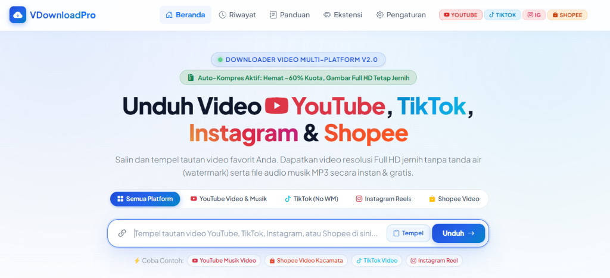

# 🚀 VDownload Pro - Multi-Platform Video & Music Downloader

[](https://php.net/)
[](https://getbootstrap.com/)
[](mailto:cs.baguosps@gmail.com)
[](mailto:cs.baguosps@gmail.com)

<p align="center">
  
</p>

**VDownload Pro** adalah aplikasi web modern, ringan, dan cepat untuk mengunduh video dan audio musik dari **YouTube**, **TikTok**, **Instagram Reels**, dan **Shopee Video** tanpa tanda air (*no watermark*) dengan kualitas **Full HD Asli (1080p / 720p)** dan audio stereo jernih.

Aplikasi ini dilengkapi dengan mesin **Kompresi Cerdas Berakselerasi GPU NVIDIA (NVENC)** agar ukuran berkas hemat kuota **tanpa mengurangi ketajaman video (anti-pecah)**, serta memiliki **Ekstensi Browser Standalone** resmi untuk kemudahan unduh 1-klik langsung di halaman web.

---

## ✨ Fitur Unggulan

### 1. 🎬 Multi-Platform Video Extractor
* **YouTube**:
  * Unduh Video Full HD 1080p, HD 720p, dan SD hemat kuota.
  * Unduh Audio Musik MP3 / M4A resolusi tinggi (High Quality).
  * Mendukung YouTube Video biasa, YouTube Shorts (`/shorts/`), dan YouTube Music (`music.youtube.com`).
  * Unduh Cover / Thumbnail resolusi asli (HD JPG).
* **Shopee Video (Tanpa Watermark)**:
  * Mengekstrak stream asli VOD Shopee.
  * Pilihan **⭐ True Master HD**: Kualitas asli rekaman kamera tanpa kompresi dan tanpa watermark template Shopee.
  * Pilihan **Web SD**: Kualitas hemat kuota untuk ponsel.
  * Pilihan Versi Aplikasi (dengan watermark) & Cover HD.
* **TikTok (Tanpa Watermark)**:
  * Unduh True HD & Clean SD tanpa tanda air TikWM / TikTok.
  * Unduh musik latar belakang (MP3).
  * Menampilkan avatar kreator, statistik penayangan, suka, dan komentar.
* **Instagram Reels & Post**:
  * Unduh video Reels dan Postingan resolusi HD.
  * Ekstraksi multi-lapis (GraphQL + Client Session).
  * Unduh Cover / Thumbnail HD.

---

### 2. ⚡ Mesin Kompresi Cerdas & Cepat (Anti-Pecah)
* **Akselerasi Perangkat Keras GPU NVIDIA NVENC**:
  * Otomatis memanfaatkan kartu grafis NVIDIA (`h264_nvenc`) untuk encoding video super cepat (1 menit video selesai hanya dalam **~5-7 detik**).
  * Fallback otomatis ke CPU multi-threaded jika sistem tidak memiliki GPU NVIDIA.
* **Kualitas Kristal (Anti-Pecah)**:
  * Mempertahankan **100% resolusi asli** (1080p tetap 1080p, 720p tetap 720p).
  * Dilengkapi algoritma **Adaptive Quantization (AQ)** dan CRF 22 seimbang sehingga detail wajah, teks, dan gerakan cepat tidak blur atau kotak-kotak.
* **Konfirmasi Cerdas Ukuran Besar**:
  * Video besar (> 30 MB) otomatis diberikan pilihan dialog interaktif: apakah ingin dikompresi Full HD (menghemat ~40–60% kuota) atau mengunduh berkas mentah langsung.
* **FastStart Ready**:
  * Menggunakan flag `+faststart` (moov atom di awal file) sehingga video langsung dapat diputar seketika di semua pemutar video HP dan laptop.

---

### 3. 🧩 Ekstensi Browser Resmi (Chrome & Edge)
* Ekstensi browser mandiri (*standalone*) di folder `extension/` (Manifest V3).
* **Tombol Unduh Mengambang**: Otomatis muncul di sudut halaman video TikTok, Shopee, Instagram, dan YouTube.
* **Popup 1-Klik**: Tempel tautan atau unduh langsung video dari tab aktif.
* **Mode Mandiri & Sinkronisasi Server**: Dapat bekerja 100% mandiri di browser atau terhubung ke server VDownload untuk kompresi GPU instan.

---

### 4. 🎨 Tampilan Modern & Responsif
* Desain elegan bertema **Putih & Biru Modern** (*Clean, Minimalist & Glassmorphism*).
* Responsive di semua ukuran layar: Ponsel, Tablet, dan Komputer Desktop.
* Pratinjau Pemutar Video langsung di browser sebelum mengunduh.
* Riwayat unduhan tersimpan secara lokal dan dapat dikelola dengan mudah.

---

## 📂 Struktur Direktori Proyek

```
vdownload/
├── .htaccess                      # Konfigurasi Apache mod_rewrite
├── .gitignore                     # Filter berkas Git
├── index.php                      # Front Controller & Autoloader PSR-4
├── README.md                      # Dokumentasi Proyek
├── app/
│   ├── Config/
│   │   └── Config.php             # Pengaturan aplikasi & URL dasar
│   ├── Core/
│   │   ├── Controller.php         # Base Controller MVC
│   │   ├── Router.php             # Router HTTP GET & POST
│   │   ├── MediaInspector.php     # Pemeriksa stream & resolusi media
│   │   └── DownloaderInterface.php# Interface standar extractor
│   ├── Controllers/
│   │   ├── HomeController.php     # Controller halaman Beranda, Riwayat, Panduan, Pengaturan
│   │   └── DownloadController.php # Controller API ekstraksi & kompresi media
│   ├── Models/
│   │   ├── MediaCompressor.php    # Mesin kompresi GPU NVENC & CPU multi-thread
│   │   ├── YouTubeDownloader.php  # Ekstraktor Video & Audio YouTube
│   │   ├── ShopeeDownloader.php   # Ekstraktor Shopee Video VOD
│   │   ├── TikTokDownloader.php   # Ekstraktor TikTok No-Watermark
│   │   ├── InstagramDownloader.php# Ekstraktor Instagram Reels
│   │   ├── DownloadHistory.php    # Pengelola riwayat unduhan
│   │   └── SettingModel.php       # Pengelola pengaturan aplikasi
│   └── Views/
│       ├── layouts/               # Template Header, Navbar, Footer
│       └── home/                  # Tampilan Beranda, Riwayat, Panduan, Pengaturan
├── assets/
│   ├── css/style.css              # Desain visual White & Blue
│   ├── js/app.js                  # Interaksi antarmuka & progress bar
│   └── img/preview.png            # Tangkapan layar antarmuka aplikasi
├── extension/                     # Berkas Ekstensi Browser (Manifest V3)
│   ├── manifest.json              # Konfigurasi ekstensi
│   ├── background.js              # Service worker latar belakang
│   ├── content.js & content.css   # Widget floating download di web
│   ├── popup.html & popup.js      # Antarmuka popup ekstensi
│   └── extractor.js               # Mesin ekstraksi mandiri di browser
├── downloads/                     # Direktori paket zip ekstensi
└── storage/                       # Direktori cache dan pengaturan lokal
```

---

## 🛠️ Persyaratan Sistem

* **Web Server**: Apache dengan modul `mod_rewrite` aktif (misal: XAMPP / Laragon).
* **PHP**: Versi **8.2** atau lebih tinggi (ekstensi `curl`, `json`, `mbstring`, `zip`).
* **FFmpeg**: Terpasang di sistem PATH atau di folder `bin/ffmpeg.exe` (opsional namun sangat disarankan untuk kompresi video & ekstraksi MP3).
* **Browser**: Google Chrome, Microsoft Edge, Brave, atau browser Chromium lainnya.

---

## 🚀 Panduan Instalasi & Penggunaan

### 1. Menjalankan Website (XAMPP):
1. Salin atau kloning folder ini ke direktori web server Anda:
   * Contoh: `C:\xampp\htdocs\vdownload\`
2. Pastikan modul **Apache** di XAMPP Control Panel telah dijalankan.
3. Buka browser dan akses:
   ```
   http://localhost/vdownload/
   ```
4. Tempel tautan video YouTube, TikTok, Instagram, atau Shopee Video, lalu klik tombol **Unduh Video**.

### 2. Memasang Ekstensi Browser:
1. Buka browser Chrome / Edge, lalu masuk ke alamat:
   ```
   chrome://extensions
   ```
2. Aktifkan sakelar **Mode pengembang (Developer mode)** di sudut kanan atas.
3. Klik tombol **Muat yang belum dibongkar (Load unpacked)** di sudut kiri atas.
4. Pilih folder `extension` di dalam proyek:
   * `C:\xampp\htdocs\vdownload\extension`
5. Ekstensi siap digunakan! Ikon **VDownload Pro** akan muncul di bilah alat browser Anda.

---

## 🔒 Kebijakan & Penggunaan Bijak

Aplikasi ini ditujukan untuk mempermudah pencadangan data pribadi, keperluan edukasi, dan mengunduh konten publik yang Anda miliki atau memiliki izin untuk mengunduhnya. Harap hormati hak cipta dan ketentuan layanan masing-masing platform.

---

## 📄 Hak Cipta & Pengembang

* **Aplikasi**: VDownload Pro
* **Pengembang**: [cs.baguosps@gmail.com](mailto:cs.baguosps@gmail.com)
* **Hak Cipta**: &copy; 2026 **cs.baguosps@gmail.com**. Seluruh hak cipta dilindungi undang-undang.
